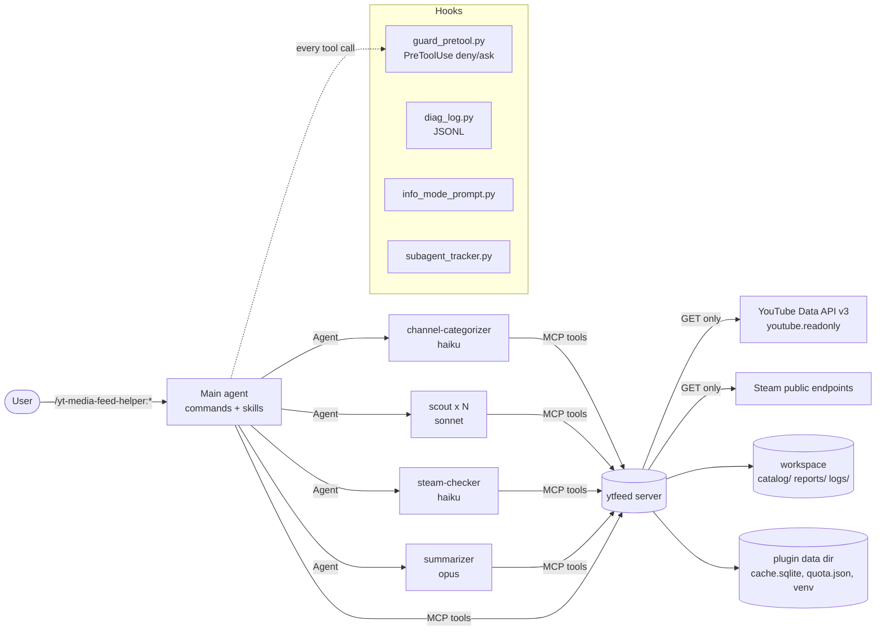

# Architecture

This document describes the current architecture of the `yt-media-feed-helper` Claude Code plugin. For installation and
usage see the [plugin README](../yt-media-feed-helper/README.md); for the threat model see [SECURITY.md](SECURITY.md).

## 1. Overview

The plugin turns Claude Code into a read-only research assistant for YouTube creators and Steam games. It has three
layers:

1. **MCP server `ytfeed`** (Python) — the only component that talks to external APIs. It enforces read-only access,
   quota accounting, sanitization of untrusted content, the evidence registry and report validation.
2. **Claude Code orchestration** — commands, skills and four subagents that plan, gather facts in parallel and write
   the report.
3. **Hooks** — a fail-closed guard that decides `deny` / `ask` for risky tool calls, plus diagnostic JSONL logging.



## 2. MCP server `ytfeed`

- Location: `yt-media-feed-helper/server/`. Started by `.mcp.json` as `python -I ${CLAUDE_PLUGIN_ROOT}/server/launch.py serve`.
- `launch.py` (stdlib only) manages a private venv in `${CLAUDE_PLUGIN_DATA}/venv` built from `requirements.lock`
  (optionally `requirements.hashes.txt` with `--require-hashes`), then runs the server in isolated mode with
  `cwd` = the server directory. Subcommands: `serve`, `install`, `auth`, `doctor`.
- Package `ytfeed/`, built on the `mcp` SDK 2.x (`MCPServer`). Logs go to stderr only.

### 2.1 Tools (23)

In Claude Code they appear as `mcp__plugin_yt-media-feed-helper_ytfeed__<tool>`.

| Group | Module | Tools |
|---|---|---|
| Catalog & taxonomy (9) | `tools/catalog_tools.py` | `taxonomy_get`, `catalog_query`, `catalog_get_channel`, `catalog_sync_subscriptions`, `catalog_propose`, `catalog_list_proposals`, `catalog_commit`, `catalog_set_manual`, `catalog_add_channel` |
| YouTube (5) | `tools/youtube_tools.py` | `yt_channel_profile`, `yt_recent_uploads`, `yt_video_details`, `yt_comments`, `yt_search` |
| Steam (3) | `tools/steam_tools.py` | `steam_find_app`, `steam_news`, `steam_reviews` |
| Meta (5) | `tools/meta_tools.py` | `quota_status`, `quota_estimate`, `auth_status`, `evidence_resolve`, `stance_stats` |
| Reports (1) | `tools/report_tools.py` | `report_save` |

Tools register through a shared `@tool` decorator (`tools/registry.py`) that converts errors into structured results
(`ToolError` codes such as `AUTH_REQUIRED`, `SCOPE_MISMATCH`, `REPORT_BUDGET_EXCEEDED`, `QUOTA_RESERVE_REACHED`,
`INVALID_ARG`, each with a `hint`). Results are shaped JSON: field projection (`fields`), truncation, cursors for paging.

### 2.2 Resources (6) and prompts (3)

- Resources: `catalog://categories`, `catalog://channels`, `catalog://channels/{channel_id}`,
  `catalog://proposals/pending`, `quota://today`, `reports://index`. Subagents do not use resources; they have equivalent tools.
- Prompts: `report_request`, `categorize_channels`, `review_proposals` (manual use via `/mcp`).

### 2.3 Sources abstraction

`sources/base.py` defines a `Source` protocol (`resolve_entity`, `list_items`, `list_reactions`, `estimate_cost`) and a
`SourceRegistry`, with normalized models `Entity` (channel, game), `Item` (video, news post) and `Reaction` (comment,
review). `sources/youtube.py` and `sources/steam.py` implement it; `yt_*` / `steam_*` tools are thin adapters.

All network access goes through `sources/http.py`: fixed base URLs, an allowlist of YouTube endpoints, GET only,
`follow_redirects=False`, retry with backoff for 429 / 5xx / rate-limit errors, and a 1 request/second limiter for the
Steam Store. In mock mode the same parsing code runs against `MockTransport` (`sources/mock.py`), which reads fixtures
from `tests/fixtures/`. Adding a new source (RSS, Bluesky…) means a new `Source` class plus a registry entry.

`sources/common.py` holds shared heuristics: term matching with inflection tolerance and `term_aliases`, comment language
detection (Polish / English keyword lists and diacritics; undetermined language is kept as `lang: null`), and error mapping.

### 2.4 Untrusted content

Every string that originates on the internet (titles, descriptions, comments, reviews, news bodies) is returned inside an
`untrusted` envelope after sanitization (`sanitize.py`): zero-width and bidi characters removed, code fences and pseudo-tags
neutralized, and an `injection_suspect` flag set when instruction-like markers are found. Links inside descriptions are
returned as data and never followed.

### 2.5 Evidence registry and report validation

- `evidence.py`: every external item gets a stable **ref** — `yt:ch:<id>`, `yt:v:<id>` (optionally `@<seconds>`),
  `yt:c:<id>`, `st:app:<appid>`, `st:n:<gid>`, `st:r:<id>` — stored in the cache with its canonical URL, title, date,
  author and a short excerpt. URLs are always derived from the ref (or an allowlisted Steam/YouTube URL), never taken from
  content. `evidence_resolve` lets agents look refs up.
- `reports.py` + `report_save`: the summarizer writes Markdown with `[[ref]]` citations. Each H2 section is followed by
  an invisible marker `<!-- section:KEY -->` (`tldr`, `findings`, `official`, `semi_official`, `creator_voices`,
  `community_reception`, `steam`, `discrepancies`, `methodology`); reports without markers fall back to English / Polish
  heading keywords. Strict validation requires a ref on every paragraph and bullet of claim sections, a ref of the right
  kind on quotes, refs on numeric lines in `discrepancies` and italic notes, a `methodology` section, and rejects any link
  or image whose target is not a registry URL. Refs are then rendered to canonical links and a "Sources" section is
  generated (heading in the report language, marker `<!-- section:sources -->`). The front matter carries `query_spec`
  and a `quality` block. `report_save` returns section anchors for the chat TL;DR.
- `stance_stats` is the only source of opinion counts and percentages: it computes counts, like-weighted shares
  (`log(1+likes)`) and Wilson 95% intervals, and suppresses percentages for samples smaller than 30.

### 2.6 Quota ledger and report budget

`quota.py` keeps a `QuotaLedger` in `<data_dir>/quota.json` under a file lock (`msvcrt` / `fcntl`). Costs come from
`catalog/config.yaml` (`channels.list` 1, `videos.list` 1, `commentThreads.list` 1, `search.list` 100, …). Cost is
**reserved before** each API call and adjusted afterwards; the day resets at midnight Pacific Time; below the reserve only
zero-cost tools run; a `quotaExceeded` response marks the bucket exhausted until reset.

A report opens a budget with `quota_estimate(plan, begin_report=true)` (default 2000 units). Exceeding it returns
`REPORT_BUDGET_EXCEEDED`. A higher one-off budget (`budget_units`) triggers a permission prompt via the guard; a permanently
higher budget comes only from the `report_budget_units` plugin option / `YTFEED_REPORT_BUDGET_UNITS` (config files can only
lower it). Budgets expire after a TTL (default 120 min) or at the daily reset, and are closed with `end_report=true`.
Catalog sync, `yt_channel_profile` and `catalog_add_channel` do not count against the report budget.

### 2.7 Catalog and taxonomy model

Files live in `<workspace>/catalog/`:

- `taxonomy.yaml` — **dimensions**, each with a `label`, `cardinality` (`single` / `multi`), `open` (whether agents may
  propose new values), `required`, optional `agent_settable` (values agents may set; the rest are manual only), and
  `values` (`key`, optional `description`, `parent` for hierarchy, `synonyms`, `steam_appids`, flags such as `official`
  and `semi_official`). Default dimensions:

  | Dimension | Values (default template) |
  |---|---|
  | `channel_type` | YouTube creator, Book author, Book reviewer, Game publisher, Game developer, Game reviewer, Film producer, Media outlet, Streamer |
  | `content` | Gaming, Books, Movies, TV series, Anime, Politics, History, Science |
  | `communication` | Official, Community Manager, Media partner, Unofficial, Not applicable |
  | `specialization` | hierarchical and open, e.g. Strategy → Grand strategy → Europa Universalis / Hearts of Iron; Gameplay, Guides, Lore; Brandon Sanderson → Cosmere |
  | `subscription` | Supporter (manual only — the API cannot see memberships), Subscriber, None |
  | `language_region` | PL, EN, DE, multi |

  Plus top-level `aliases` (natural-language words → dimension value, e.g. `eu5` → specialization Europa Universalis;
  Polish aliases such as `strategia` are kept alongside English ones) and `term_aliases` (e.g. Europa Universalis V =
  EU5; Rzeczpospolita Obojga Narodów = RON / Rzplita / PLC / Polish-Lithuanian Commonwealth) used for query expansion
  and term matching.
- `channels.yaml` — one entry per channel: `title`, `handle`, `sources` (`youtube.channel_id`, `uploads_playlist`,
  `steam.appids`), `status` (`uncategorized` / `approved` …), `added_via`, and `categories`: per dimension a list of
  `{value, source: agent|user, confidence, rationale, evidence_refs, approved_by_user_at}`. Values set by the user are
  `locked` and never overwritten by agents.
- `config.yaml` — tunables (windows, limits, quota costs, parallelism, guard tightening).
- `proposals/<channel_id>.json` — pending categorization proposals.
- `history.jsonl` — append-only log of committed decisions.

`catalog/rules.py` implements filter semantics (AND across dimensions, OR within a dimension, parent values include
descendants, aliases and synonyms, `exclude`, `min_confidence`) shared by `catalog_query` and the stdlib validator script.
The server records a sha256 of `channels.yaml` after every MCP write, so edits made outside MCP are detected and reported.

### 2.8 Proposals → approval → commit

1. `catalog_propose` (only allowed for the `channel-categorizer` subagent) writes a proposal per channel; new values for
   open dimensions are flagged; missing required dimensions keep the proposal `pending` with `needs_input`.
2. `catalog_list_proposals` renders an escaped Markdown table for review (low-confidence values and new values marked).
3. The user decides in chat; the main agent builds `decisions` (accept / reject / overrides), `approve_new_values` and
   optional `set_steam_appids`.
4. `catalog_commit` is always gated by the guard hook as **ask**, with the full decision content in the native permission
   prompt; for subagents and non-interactive permission modes it is denied. On approval the server writes
   `channels.yaml`, `taxonomy.yaml` and `history.jsonl` atomically. Overrides become `source: user` and are locked.
   `catalog_set_manual` (e.g. `Supporter`) and `catalog_add_channel` follow the same ask rule.

## 3. Subagents

Each subagent has an explicit minimal `tools` list (only specific `ytfeed` tools — no Bash, Write, Edit, WebFetch or
Agent), a `maxTurns` limit and an "untrusted data" section in its prompt.

| Agent | Model | Tools | Role |
|---|---|---|---|
| `channel-categorizer` | haiku | `taxonomy_get`, `catalog_get_channel`, `yt_channel_profile`, `yt_video_details`, `catalog_propose` | Categorizes one channel and writes a proposal; never commits. Run in waves (default 5 in parallel). |
| `scout` | sonnet | `catalog_get_channel`, `yt_recent_uploads`, `yt_video_details`, `yt_comments`, `quota_status` | Collects facts with refs from a group of channels: uploads, chapters, official replies, representative comments, stance per ref. Output is bounded (≤ 30 facts, ≤ 12 quotes). |
| `steam-checker` | haiku | `steam_find_app`, `steam_news`, `steam_reviews`, `taxonomy_get` | Resolves appids / upcoming DLC (suggests, never picks silently when ambiguous), news and patch notes, reviews filtered by language and window. |
| `summarizer` | opus | `evidence_resolve`, `stance_stats`, `report_save` | Merges subagent outputs into the report in the language of the question and saves it through the validator. |

The `subagent_tracker.py` hook tracks active subagents per session and the guard caps a wave at
`parallelism.max_active_subagents` (default 6: five scouts + steam-checker).

## 4. Skills and commands

| Skill | Uses MCP | Purpose |
|---|---|---|
| `feed-guide` | yes | How to query the catalog, aliases, quota costs, ref and report formats (references in `references/`). |
| `catalog-workflow` | yes | Sync → categorize in waves → review → commit. |
| `report-workflow` | yes | Parse the question into a `query_spec`, select channels, estimate quota, fan out scouts and steam-checker, run the summarizer. |
| `taxonomy-edit` | no | Edit and validate `taxonomy.yaml` / `channels.yaml` (`scripts/validate_catalog.py`). |
| `diag-stats` | no | Statistics from `logs/diag-*.jsonl` and `guard-*.jsonl`. |
| `reports-browse` | no | List, search and lint saved reports, regenerate `reports/index.md`. |
| `catalog-export` | no | Export the catalog as a Markdown table or CSV. |

Commands (`commands/*.md`) are thin wrappers that load a skill: `catalog-sync [--apply]`, `categorize`,
`review-categories`, `report <question> [--window 14d] [--search]`, `diag`, `quota`, `doctor`.

## 5. Hooks

All hooks run as `python -I ${CLAUDE_PLUGIN_ROOT}/hooks/scripts/<script>.py` and use only the standard library.

| Event | Script | Purpose |
|---|---|---|
| `PreToolUse` (Bash, PowerShell, WebFetch, Write, Edit, MultiEdit, NotebookEdit, NotebookRead, Agent, Task, Read, Grep, Glob, `mcp__.*`) | `guard_pretool.py` | Returns only `deny` or `ask` (never `allow`); fail-closed (`onFailure: block`, exit code 2 on errors). See [SECURITY.md](SECURITY.md). |
| `UserPromptSubmit` | `info_mode_prompt.py` | Detects information requests (English and Polish keywords), adds context steering to the report workflow and switches on info-mode guard rules. |
| `SessionStart` | `session_start.py` | One-line status (catalog size, uncategorized, pending proposals, quota, workspace) from local files only. |
| `SessionStart`, `SubagentStart`, `SubagentStop` | `subagent_tracker.py` | Per-session tracking of active subagents for the wave limit. |
| all events (async) | `diag_log.py` | JSONL diagnostics: tool calls per agent / subagent, durations, result sizes, errors, quota cost; secrets redacted. |

## 6. Data locations

| Location | Contents |
|---|---|
| `<workspace>` = `YTFEED_WORKSPACE` / `workspace_dir` option, else the project directory | `catalog/` (taxonomy, channels, config, proposals, history), `reports/YYYY-MM-DD-<topic>.md` + `index.md`, `logs/diag-*.jsonl`, informational copy of `logs/guard-*.jsonl` |
| `${CLAUDE_PLUGIN_DATA}` (plugin data dir) | `venv/`, `cache.sqlite` (response cache + evidence registry, TTL ≤ 30 days), `quota.json`, catalog integrity hash, hook session state, `logs/guard-*.jsonl` (source of truth) |
| Secrets dir = `YTFEED_SECRETS_DIR`, else `%APPDATA%\yt-media-feed-helper` (Windows) / `~/.config/yt-media-feed-helper` (POSIX) | `token.json` (DPAPI-encrypted on Windows, `0600` on POSIX), optional `client_secret.json` |
| Environment / OS secure store | Google client ID and secret (`YTFEED_*` variables or plugin options) |
| `${CLAUDE_PLUGIN_ROOT}/templates/` | `taxonomy.default.yaml`, `config.default.yaml` copied into a new workspace |

## 7. Request flows

### 7.1 Cataloging

```text
/yt-media-feed-helper:catalog-sync
  catalog_sync_subscriptions(dry_run=true)          -> new / lost channels, cost (a few units)
  catalog_sync_subscriptions(dry_run=false)         -> guard: ask -> user approves -> channels.yaml
/yt-media-feed-helper:categorize uncategorized
  catalog_query(status=uncategorized)
  wave: 5 x Agent(channel-categorizer)              -> guard enforces the wave limit
     each: taxonomy_get -> catalog_get_channel -> yt_channel_profile -> [yt_video_details] -> catalog_propose
  next wave after the previous one finishes
/yt-media-feed-helper:review-categories
  catalog_list_proposals(format=table)              -> table in chat
  user: "1-20 OK; 7: communication=Media partner; 12: reject"
  catalog_commit(decisions, ...)                    -> guard: ask with full content -> channels.yaml + taxonomy.yaml + history.jsonl
```

Re-categorization: `/yt-media-feed-helper:categorize @handle …` or `all` (channels categorized under an older
`taxonomy_version`); locked dimensions are skipped.

### 7.2 Reporting

```mermaid
sequenceDiagram
    participant U as User
    participant M as Main agent (report-workflow)
    participant S as ytfeed
    participant SC as scout x N
    participant ST as steam-checker
    participant SU as summarizer
    U->>M: /yt-media-feed-helper:report <question>
    Note over M: UserPromptSubmit hook adds info-mode context
    M->>S: taxonomy_get, catalog_query(filters)
    M->>S: quota_estimate(plan, begin_report=true)
    par per channel group
        M->>SC: brief (channels, window, terms, mode)
        SC->>S: yt_recent_uploads, yt_video_details, yt_comments
        SC-->>M: facts + refs + stance_refs (JSON)
    and if games are in scope
        M->>ST: brief (game, window, language)
        ST->>S: steam_find_app, steam_news, steam_reviews
        ST-->>M: facts + refs (JSON)
    end
    M->>SU: subagent outputs verbatim + query_spec
    SU->>S: stance_stats, evidence_resolve
    SU->>S: report_save(markdown, language, quality)
    S-->>SU: path + anchors (or validation errors to fix)
    SU-->>M: chat summary
    M->>S: quota_estimate(plan=[], end_report=true)
    M-->>U: 3–5 bullet TL;DR with links + report path + quota used
```

1. The main agent turns the question into a `query_spec`: `mode` (`news` or `reception`), filters, window, topic terms
   (expanded with aliases), language of the question, games. A critical ambiguity produces one question to the user.
2. `catalog_query` selects channels; with zero results the agent suggests relaxing filters or `yt_search` (with consent).
3. `quota_estimate` opens the report budget; the plan is shrunk if it does not fit.
4. Scouts run in parallel per channel group (official / Community Manager channels get their own group without a
   language filter); `steam-checker` runs when games are in scope. In reception mode comments are sampled with
   `order="mixed"`, deduplicated and weighted; for questions about a change, a T0 date splits before/after.
5. The summarizer writes the report in the question's language, with numbers only from `stance_stats`, and saves it via
   `report_save`, which validates citations and links.
6. The chat gets a 3–5 bullet TL;DR linking to report section anchors; the budget is closed.
